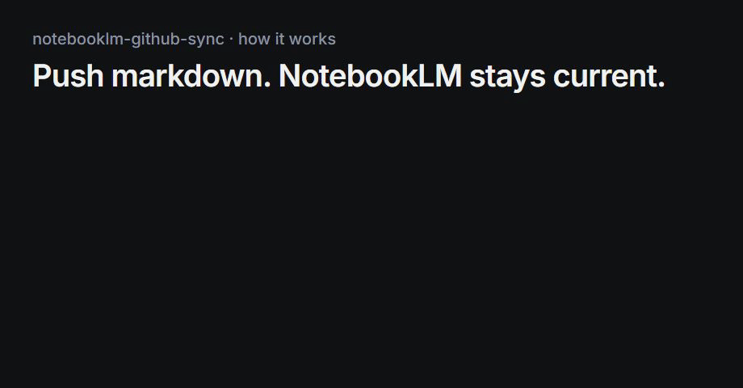

# notebooklm-github-sync


[](https://github.com/patrick-creates/notebooklm-github-sync/actions/workflows/test.yml)
[](https://www.telosignal.com/blog/github-notebooklm-sync-blog)

**Your NotebookLM notebook goes stale the moment your repo docs change — and re-uploading markdown by hand doesn't scale.**

A GitHub Action that auto-syncs your repository's markdown files to Google NotebookLM on every push, keeping your AI notebook current without manual uploads.



⭐ If this saves you manual uploads, a star helps others find it.

## What it does

- Watches for `.md` file pushes in your repo
- Groups files by top-level folder into one source each (`docs/` → `docs.md`)
- Deletes the old source, uploads a fresh bundle — no duplicate accumulation
- Only re-syncs folders that contain changed files (31-second runs on normal pushes)
- Force-sync option to refresh everything at once

## Why this exists

Most NotebookLM sync approaches either require enterprise infrastructure or aren't designed as GitHub Actions:

| Approach | Target user | Limitation |
|----------|-------------|------------|
| `storage-notebooklm-sync` | Enterprise users with GCS | Requires NotebookLM Enterprise + Google Cloud setup |
| `notebooklm-mcp-cli` | Developers using Claude/Cursor | General-purpose CLI — not a GitHub Action, no CI/CD |
| Manual upload | Everyone | Breaks the moment you forget. Doesn't scale. |
| **This tool** | **Any developer with a free NotebookLM account** | Cookie expiration requires periodic re-auth (~5 min) |

This tool targets the common case: a developer who wants their docs notebook to stay current, using only a free Google account.

## Quick start

**1. Authenticate (one time)**

Run this inside a clone of the repo you want to sync — the secrets go to that repo:

```bash
curl -O https://raw.githubusercontent.com/patrick-creates/notebooklm-github-sync/main/nlm_auth.py
python nlm_auth.py
```

Opens browser → Google login → credentials saved → GitHub secrets set automatically (requires [GitHub CLI](https://cli.github.com)) or printed for manual copy. The script prints which repo it writes to; use `--repo owner/repo` to pick another.

You'll need your **NOTEBOOK_ID**: open your notebook at [notebooklm.google.com](https://notebooklm.google.com) and copy the ID from the URL after `/notebook/`.

**2. Add the workflow to your repo**

Create `.github/workflows/sync_docs.yml` in the repo you want to sync (or copy [`sync_docs.yml`](./sync_docs.yml)):

```yaml
name: Sync Repo to NotebookLM

on:
  push:
    paths:
      - '**.md'
  workflow_dispatch:
    inputs:
      force_sync:
        description: 'Force sync all bundles'
        type: boolean
        default: false

jobs:
  sync:
    runs-on: ubuntu-latest
    steps:
      - uses: actions/checkout@v4
        with:
          fetch-depth: 0   # needed to see which files changed

      - uses: patrick-creates/notebooklm-github-sync@v1
        with:
          notebook-id: ${{ secrets.NOTEBOOK_ID }}
          cookies: ${{ secrets.NOTEBOOKLM_COOKIES }}
          metadata: ${{ secrets.NOTEBOOKLM_METADATA }}
          force-sync: ${{ inputs.force_sync || false }}
```

| Input | Required | Default | Purpose |
|---|---|---|---|
| `notebook-id` | yes | — | ID from the notebook URL |
| `cookies` | yes | — | `NOTEBOOKLM_COOKIES` secret from `nlm_auth.py` |
| `metadata` | no | `{}` | `NOTEBOOKLM_METADATA` secret from `nlm_auth.py` |
| `force-sync` | no | `false` | Re-upload every folder, not only changed ones |

**3. Push any `.md` file**

The Action runs automatically on every markdown push from here.

## Full guide

→ [Auto-Sync GitHub to NotebookLM with GitHub Actions — Setup Guide](https://www.telosignal.com/blog/github-notebooklm-sync-blog)

## Files

| File | Purpose |
|---|---|
| `nlm_auth.py` | One-time authentication — sets `NOTEBOOKLM_COOKIES`, `NOTEBOOKLM_METADATA`, `NOTEBOOK_ID` secrets |
| `action.yml` | The Action: installs the CLI, restores the login, runs the sync |
| `scripts/sync.sh` | Bundling and upload logic |
| `sync_docs.yml` | Example workflow — copy to `.github/workflows/` in your target repo |
| `tests/test_sync.sh` | Runs the sync logic against a throwaway repo with the CLI mocked: `bash tests/test_sync.sh` |
| `.github/workflows/test.yml` | Runs the tests on every push and pull request |

## Requirements

- Python 3.11+ (required by `notebooklm-mcp-cli` 0.15.5)
- `notebooklm-mcp-cli` 0.15.5 (installed by `nlm_auth.py`; the Action pins the same version)
- GitHub repository with `.md` files
- Google account with access to a NotebookLM notebook
- Optional: [GitHub CLI](https://cli.github.com) for automated secret setup

## Is this safe?

Read this before you set it up. In short: treat the cookies like a password, and only sync repos whose Markdown you are fine sending to Google.

**What the cookies are.** `nlm_auth.py` runs `nlm login`, which saves your Google session cookies under `~/.notebooklm-mcp-cli/profiles/default/`. They are login cookies for your Google account, not a key limited to one notebook. Anyone who has them can act as that Google session until they expire.

**Where they go.**
- With the GitHub CLI: straight into the repo's encrypted Actions secrets (`NOTEBOOKLM_COOKIES`, `NOTEBOOKLM_METADATA`). Nothing is printed.
- Without it, outside a GitHub repo, or if `gh secret set` fails: printed to your terminal for manual copy. Clear your terminal scrollback afterwards.
- In the Action: written to `$HOME/.notebooklm-mcp-cli/` on the runner for the duration of the job. GitHub-hosted runners are discarded after the job. On a **self-hosted runner** the file stays on disk — delete it or don't use this there.
- GitHub masks secret values in logs. The Action never echoes them.

**Who can use them.** Anyone with write access to the repo can create a workflow that reads the secrets. Don't add these secrets to repos where people you don't trust can push. Workflows triggered from forks don't receive secrets.

**What leaves your repo.** Every `.md` file outside hidden folders (`.github/` and other folders starting with `.`), bundled per top-level folder, goes to NotebookLM. That includes drafts, notes and anything else in Markdown. Check before the first run; use a separate repo or move private notes into a hidden folder if needed.

**Unofficial API.** `notebooklm-mcp-cli` talks to NotebookLM the way the web app does; Google offers no public API for this. Google can change it at any time and the sync breaks until the CLI catches up. The Action pins one CLI version so an upstream release can't change behaviour silently.

**Safer setup.** Use a separate Google account that only owns the notebook, and share the notebook with your main account. Then the cookies in GitHub can't reach your mail or Drive.

## Limitations

- **Cookie expiration:** Google session cookies expire periodically. When the Action fails with an auth error, re-run `python nlm_auth.py` and update `NOTEBOOKLM_COOKIES` and `NOTEBOOKLM_METADATA` in GitHub Settings → Secrets with the fresh values. Takes about 5 minutes.
- **Free accounts only:** This tool does not require NotebookLM Enterprise or Google Cloud Platform. It works with free NotebookLM accounts. Enterprise-grade GCS sync is out of scope.
- **Markdown only:** Only `.md` files are synced. Other file types are ignored.
